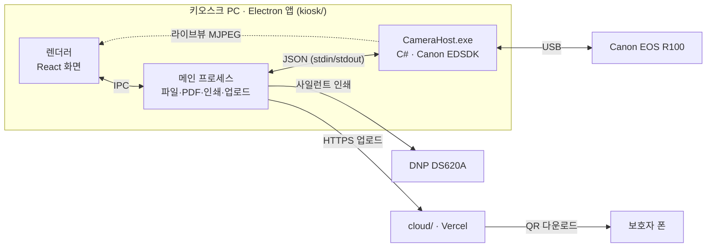

# 마이 드림 보이스 (My Dream Voice)

한국잡월드 체험관에 설치하는 **AI 음성 분석 기반 체험형 포토 키오스크**입니다.
아이가 직업 대사를 말하며 네컷 사진을 찍으면 —

- **아이에게**: 추천 직업 + 네컷 사진 (현장 인화)
- **보호자에게**: 오늘 발화에 대한 관찰 기반 안내 리포트 (QR → PDF)

발음 분석은 **키오스크 안에서만(오프라인)** 합니다. 인터넷은 보호자 리포트를 올리는 순간에만 씁니다.

> 현재 단계: **스파이크(기술 검증)** — 촬영 → 인쇄 → QR까지 전체 경로를 먼저 관통시키고, 분석은 가짜 결과로 자리만 잡아 둔 상태입니다.

---

## 구조



| 구성 | 위치 | 하는 일 |
| --- | --- | --- |
| 렌더러 | `kiosk/src/renderer` | 화면만 그린다. 파일·프린터에는 직접 손대지 않고 IPC로 요청만 한다 |
| 메인 프로세스 | `kiosk/src/main` | 세션 폴더, PDF 생성, 인쇄, 업로드, 카메라 프로그램 관리 |
| 카메라 프로그램 | `kiosk/camera-host` | R100은 웹캠(UVC)이 아니라서 Canon SDK(C DLL)로 제어하는 C# 별도 프로그램 |
| 클라우드 | `cloud` | 리포트 PDF·네컷을 받아 24시간 보관하고 QR 주소로 내려준다 |

---

## 현재 상태

| 상태 | 항목 |
| --- | --- |
| ✅ 동작 확인 | 화면 흐름 P-00~P-11 (A: 사진만 / B: 목소리 분석까지), 오류 안내(M-02) |
| ✅ | 가짜 카메라로 라이브뷰·카운트다운·4컷 촬영·USB 분리 처리 |
| ✅ | 네컷 합성 (1200×1800, 4×6인치 @300dpi) |
| ✅ | 보호자 리포트 A4 PDF · 4×6 인화 PDF 생성 |
| ✅ | 대화창 없는 인쇄 경로 · 인쇄 실패 처리 |
| ✅ | 업로드 → QR 표시 (키오스크 쪽, 로컬 임시 서버로 확인) · 실패 시 "인쇄물만 제공" 안내 |
| ✅ | D-01 하드웨어 점검 (장치 목록·마이크 레벨·16kHz WAV 녹음·스피커·카메라·인쇄) |
| 🟡 실물 확인 전 | 실제 카메라 R100 — SDK 로드·카메라 탐색까지 확인, 실촬영은 키오스크에서 시험 예정 |
| 🟡 | 실제 인쇄 (DNP 프린터) |
| 🟡 | 클라우드 — 코드 완료, 배포 전 |
| ⬜ 미구현 | P-05 녹음 연결 (녹음 기능 자체는 D-01에서 동작) |
| ⬜ | 발음 분석 — 지금은 `kiosk/src/main/mock/analysis.ts`가 가짜 결과를 준다 (ONNX로 교체 예정) |
| ⬜ | 미확정 콘텐츠 — 추천 직업 로직, 직업별 대사, 긍정 문구, 직업 프레임 그림, 디자인 |
| ⬜ | 용지 없음 감지, 운영 설정 (전체화면 고정·자동 실행·재기동) |

---

## 폴더

```
mdv/
├── README.md            ← 이 문서
├── CLAUDE.md            프로젝트 규칙 · 금지 사항 (먼저 읽기)
├── SPEC.md              기획 확정본 + 미결 사항(T-xx)
├── PAGE_SPEC.md         화면 정의서 (P-xx / M-xx)
├── SPIKE_PLAN.md        스파이크 범위 · 완료 기준
├── docs/                리포트 문구 원본, 화면 흐름도 PDF, 기획 문서
├── kiosk/               키오스크 앱 (Electron + Vite + React + TS)
│   ├── src/main/        메인 프로세스
│   ├── src/preload/     렌더러에 window.api를 여는 통로
│   ├── src/renderer/    화면 (screens/ · store/ · photo/ · report/ · audio/)
│   ├── src/shared/      양쪽 공용 — types.ts(IPC 계약) · jobs.ts(직업·대사)
│   └── camera-host/     CameraHost.exe (C# · .NET 10)
└── cloud/               결과물 전달 서버 (Next.js on Vercel)
```

파일 단위 설명은 [kiosk/README.md](kiosk/README.md)에 있습니다.

### 코드 읽는 순서

1. `kiosk/src/shared/types.ts` — 화면과 메인이 주고받는 모든 데이터와 IPC 채널
2. `kiosk/src/renderer/store/session.ts` — 화면 전환과 세션 데이터 (라우터 없이 이 스토어 하나로 움직인다)
3. `kiosk/src/main/ipc.ts` — 요청이 어느 모듈로 가는지
4. 관심 있는 화면(`screens/`)이나 모듈

### 한 세션의 흐름

| 화면 | 하는 일 | 주요 코드 |
| --- | --- | --- |
| P-00~P-04 | 모드·직업 4개·나이·동의 | `screens/P0x*.tsx` → `store/session.ts` |
| P-05 | 직업 대사 4개 표시 (녹음 연결 예정) | `screens/P05Speak.tsx`, `shared/jobs.ts` |
| P-06 | 라이브뷰 → 카운트다운 → 4컷 촬영 → 네컷 합성 | `screens/P06Capture.tsx`, `main/camera.ts`, `photo/composeFourCut.ts` |
| P-07·08 | 분석 (지금은 가짜) → 추천 직업 | `main/mock/analysis.ts` |
| P-09 | 4×6 PDF·리포트 PDF 생성 → 인쇄, **동시에** 업로드 시작 | `main/pdf.ts`, `main/print.ts`, `main/upload.ts` |
| P-10 | 받은 주소로 QR 표시 | `screens/P10Qr.tsx` |
| P-11 | 세션 폴더 삭제 → 처음으로 | `main/storage.ts` |

---

## 시작하기

**필요한 것**: Windows 10/11 · Node.js 22 · .NET 10 SDK (카메라 프로그램을 빌드할 때만. 키오스크 PC에는 필요 없음)

```bash
cd kiosk
npm install
```

```bash
npm run camera:build
```

```bash
npm run dev
```

개발 실행은 **가짜 카메라**로 동작하고, 첫 화면은 D-01 하드웨어 점검입니다. `[플로우 시작]`으로 P-00부터 진행합니다.

### Canon EDSDK (저장소에 없음)

실제 카메라를 쓰려면 Canon에서 승인받은 EDSDK의 **64비트 DLL 2개**를 직접 넣어야 합니다.
Canon 이용약관상 DLL은 앱 패키지에만 포함하고 단독 배포하지 않으므로 저장소에서는 제외(`.gitignore`)합니다.

```
kiosk/camera-host/edsdk/EDSDK.dll      ← EDSDK_64/Dll/
kiosk/camera-host/edsdk/EdsImage.dll   ← EDSDK_64/Dll/
```

넣은 뒤 `npm run camera:build`를 다시 실행하면 exe 옆으로 복사됩니다. DLL이 없어도 가짜 카메라는 그대로 동작합니다.

### 설치 파일 만들기

```bash
npm run dist
```

`kiosk/dist/MyDreamVoice-Setup-<버전>.exe`(설치판)와 `MyDreamVoice-Portable-<버전>.exe`가 나옵니다.
**설치판은 실제 카메라(EDSDK)가 기본**입니다. 서명이 없어 처음 실행 시 "Windows의 PC 보호" → 추가 정보 → 실행.

### 테스트

| 명령 | 확인하는 것 |
| --- | --- |
| `npm run typecheck` | 메인·렌더러 타입 검사 |
| `npm run camera:test` | 카메라 프로그램 프로토콜 (가짜 카메라 20개 항목) |
| `npm run camera:test:edsdk` | 실제 R100 — 연결·라이브뷰·4컷·지연 측정. 카메라가 없으면 SDK 로드·탐색까지만 |
| D-01 `[실카메라 자가진단]` | 키오스크에서 버튼 하나로 위 시험 + 결과 폴더(사진·로그)를 바탕화면에 생성 |

카메라 로그: `%APPDATA%\MyDreamVoice\logs\camera-YYYYMMDD.log`

---

## 환경 변수

**키오스크 (`kiosk`)**

| 변수 | 뜻 | 기본값 |
| --- | --- | --- |
| `MDV_CAMERA` | 카메라 백엔드 `fake` \| `edsdk` | 개발 실행 `fake`, 설치판 `edsdk` |
| `MDV_DATA_DIR` | 세션 폴더 위치 | 개발 `kiosk/sessions`, 설치판 `%APPDATA%\MyDreamVoice\sessions` |
| `MDV_UPLOAD_ENDPOINT` | 업로드 주소 `https://<앱>.vercel.app/api/upload` | 없으면 업로드 실패 → "인쇄물만 제공" 안내 |
| `MDV_UPLOAD_SECRET` | 업로드 비밀키 (cloud와 같은 값) | — |
| `MDV_SELFTEST_FAKE`, `MDV_SELFTEST_DIR` | 개발 PC에서 자가진단 검증용 | — |

**클라우드 (`cloud`, Vercel 프로젝트 설정)** — 예시는 `cloud/.env.example`

| 변수 | 뜻 |
| --- | --- |
| `MDV_UPLOAD_SECRET` | 키오스크와 같은 비밀키 |
| `BLOB_READ_WRITE_TOKEN` | Vercel Blob 연결 시 자동 주입 |
| `CRON_SECRET` | 만료 파일 정리(cron) 호출 인증 |
| `MDV_PUBLIC_ORIGIN` | QR에 넣을 공개 주소 (예: `https://mdv.vercel.app`) |
| `MDV_TTL_MINUTES` | 만료 시간 테스트용 (기본 24시간) |

> `cloud/vercel.json`의 정리 작업은 매시간 실행입니다. Vercel Hobby 요금제는 하루 1회 cron만 허용하므로 그 경우 주기를 조정해야 합니다. 만료 여부는 다운로드 시점에도 따로 확인합니다.

---

## 지켜야 할 원칙 (요약)

자세한 내용과 이유는 [CLAUDE.md](CLAUDE.md)에 있습니다.

- 아이 음성은 기기 밖으로 나가지 않는다. 클라우드 STT·분석 API 금지, 원본 WAV 업로드 금지
- 업로드는 최종 산출물(리포트 PDF·네컷)만, 24시간 후 삭제
- 녹음 때 마이크 DSP(잡음 제거·에코 제거·자동 음량)는 모두 끈다
- 아이 화면에는 관찰 결과를 보이지 않는다. 리포트에 점수·판정·또래 비교를 넣지 않는다
- "판정" 표현 금지 — 결과는 "잘 인식됨 / 다르게 인식됨" 두 가지 관찰로만, 주어는 아이가 아니라 AI의 인식
