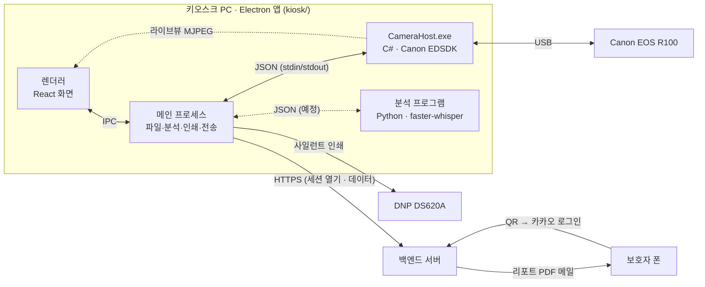

# 마이 드림 보이스 (My Dream Voice)

한국잡월드 체험관에 설치하는 **AI 음성 분석 기반 체험형 포토 키오스크**입니다.
아이가 직업 하나를 골라 그 직업의 짧은 시나리오를 따라 문장 2개를 말하고, 그 직업 프레임으로 네컷 사진을 찍으면 —

- **아이에게**: 네컷 사진 (가로, 현장 인화) + 화면 안내 (A모드: 긍정 문구 · B모드: 리포트 미리보기)
- **보호자에게**: 오늘 말한 문장에서 **ㅅ · ㅆ · ㄹ** 소리가 AI에 어떻게 인식됐는지 관찰한 리포트 (체험 전에 카카오 로그인 또는 이메일 입력 → 그 이메일로)

발음 분석은 **키오스크 안에서만(오프라인)** 합니다. 인터넷은 B모드에서 **보호자 연결(세션 열기)** 과 **리포트 데이터 전송** 두 순간에만 씁니다.
직업은 역할놀이 소재일 뿐, 어떤 직업을 추천하지는 않습니다.

> **현재 단계: 스파이크(기술 검증)** — 촬영 → 인쇄 → QR까지 전체 경로를 먼저 관통시켰고, 분석은 가짜 결과로 자리만 잡아 둔 상태입니다.
>
> 🔄 **기획 v2 (2026-11-16 · 11-18 · 11-19 · 11-20)** — 화면 흐름, 직업 · 연령 선택, 발화 방식, 네컷 방향(가로), 리포트 전달 방식이 바뀌었습니다. **문서는 v2, 코드는 아직 v1**입니다. 화면 대응은 아래 [화면과 코드](#화면과-코드), 코드에서 고칠 곳 전체는 [V2_PLAN.md](V2_PLAN.md)에 있습니다.

---

## 체험 흐름 (v2)

```
대기 → 모드 선택 → 동의(B) → 보호자 연결(B) → 연령(B) → 직업 1개 → 발화(B) → 촬영 4컷 → 분석 및 프린트 → 완료 창(5초) → 대기
                  (A는 모드 선택에서 바로 직업 선택으로 — 동의 · 보호자 연결 없음)
```

| 모드 | 아이가 하는 것 | 받는 것 |
| --- | --- | --- |
| **A. 사진만** | 직업 1개 고르기 → 촬영 (동의 화면 없음 — 모드 선택 화면에 안내 한 줄) | 네컷 인쇄 |
| **B. 목소리도** | 보호자 동의 → **보호자 연결**(카카오 로그인 QR 또는 이메일 직접 입력) → 나이(만 4 · 5 · 6+) → 직업 1개 → 시나리오를 따라 문장 2개 말하기 → 촬영 | 네컷 인쇄 + 보호자 메일 리포트 |

- **보호자 연결**에서 세션이 열리고, 인쇄가 끝나면 닫힙니다. 서버에 연결이 안 되면 [다시 시도], 그래도 안 되면 [사진만 찍기]로 A모드로 넘어갑니다.
- **발화**: 문장을 먼저 들려주고(음성 + 자막) "이제 말해 보자!" → 아이가 [말하기 시작] · [다 말했어요]를 눌러 녹음합니다. 받아쓰기로 확인해 인식이 50% 미만이면 1회 다시 말하고, 더 잘 인식된 녹음을 씁니다. 만 4세는 어절마다 끊어 따라 말합니다.

- 직업은 6개(경찰 · 우주비행사 · 가수 · 크리에이터 · 의사 · 로봇개발자) 중 하나입니다. 직업 카드가 그 직업의 네컷 프레임 그림이라, 아이가 프레임을 보고 고릅니다.
- 촬영은 7초 간격으로 4컷을 찍습니다. 네컷은 가로입니다 (사진 2×2 + 오른쪽 띠).

**분석 및 프린트 화면** 한 장에서 촬영 장면 영상을 반복 재생하며 진행도를 보여줍니다 — **B모드는 분석 중 → 프린트 중**, **A모드는 바로 프린트 중**. B모드는 분석이 끝나면 **리포트 미리보기**를 띄우고("자세한 리포트는 보호자 메일로"), 리포트 데이터를 서버로 보냅니다. 미리보기에는 관찰 결과를 넣지 않습니다. 이 화면과 인쇄물에는 QR이 없습니다.

**보호자 폰** — 보호자 연결 화면에서 카카오를 고르면:

```
화면 QR → 카카오 로그인 → "연결됐어요 · a***@naver.com으로 보내 드려요" → (체험이 끝나면) 리포트 PDF 메일
```

자세한 내용: [SPEC.md](SPEC.md) (기획) · [PAGE_SPEC.md](PAGE_SPEC.md) (화면별 정의)

---

## 구조



| 구성 | 위치 | 하는 일 |
| --- | --- | --- |
| 렌더러 | `kiosk/src/renderer` | 화면만 그린다. 파일·프린터에는 직접 손대지 않고 IPC로 요청만 한다 |
| 메인 프로세스 | `kiosk/src/main` | 세션 폴더, 발음 분석, 네컷 PDF, 인쇄, 서버 전송, 카메라 프로그램 관리 |
| 카메라 프로그램 | `kiosk/camera-host` | R100은 웹캠(UVC)이 아니라서 Canon SDK(C DLL)로 제어하는 C# 별도 프로그램 |
| 분석 프로그램 (예정) | `kiosk/analysis-host` (가칭) | 받아쓰기(faster-whisper) · 정밀 분석(스펙트로그램 · 피치 등)을 하는 파이썬 별도 프로그램. 키오스크 PC에서만 돈다 |
| 백엔드 서버 | 이 저장소 밖 | 세션 번호 발급 · 카카오 로그인 · 리포트 PDF 생성 · 메일 발송 · 저장 |
| ~~클라우드~~ | `cloud/` | v1의 업로드·QR 다운로드 서버 (Next.js · Vercel). **백엔드로 대체되어 폐기 예정** |

키오스크와 서버의 역할 · 보내는 데이터 · 세션 번호 규칙은 [SPEC.md §6](SPEC.md)에 있습니다.

---

## 현재 상태

| 상태 | 항목 |
| --- | --- |
| ✅ 동작 확인 | v1 화면 흐름 P-00~P-11 · 오류 안내(M-02) |
| ✅ | 가짜 카메라로 라이브뷰 · 카운트다운 · 4컷 촬영 · USB 분리 처리 |
| ✅ | 실제 카메라 R100 — 키오스크에서 촬영 확인 (자가진단 결과 분석은 진행 중) |
| ✅ | 네컷 합성 · 4×6 인화 PDF · 대화창 없는 인쇄 경로 · 인쇄 실패 처리 |
| ✅ | D-01 하드웨어 점검 (장치 목록 · 마이크 레벨 · 16kHz WAV 녹음 · 스피커 · 카메라 자가진단 · 인쇄) |
| 🟡 | 실제 인쇄 품질 (DNP 프린터 — 색 · 잘림 정도) |
| ⬜ v2 개편 | 화면 순서 · 동의(B만, 체크 3개) · **보호자 연결**(카카오 QR · 이메일 직접 입력 · 화면 키보드) · 연령(만 4 · 5 · 6+, 별명 삭제) · 직업 6개 중 1개 · 시나리오 발화 · 7초 촬영 · **분석 및 프린트 통합 화면**(B는 리포트 미리보기) · 촬영 장면 영상 · 완료 창 |
| ⬜ v2 개편 | 가로 네컷 1844×1240 (QR 없음) · 추천 직업 코드 삭제 |
| ⬜ v2 개편 | **백엔드 연동** — 세션 열기 · 카카오 로그인 확인 · 이메일 전달 · 데이터 전송 (API 합의 전, SPEC T-14). 개편 할 일 전체: [V2_PLAN.md](V2_PLAN.md) |
| ⬜ | 발음 분석 — 지금은 `kiosk/src/main/mock/analysis.ts`가 가짜 결과를 준다. **파이썬 별도 프로그램**(faster-whisper 받아쓰기 + 정밀 분석)으로 교체 예정 — 카메라 프로그램처럼 앱 안에 넣는다 |
| ⬜ | P-05 녹음 연결 (녹음 기능 자체는 D-01에서 동작) · 문장 들려주기 · [말하기 시작] / [다 말했어요] · 다시 말하기(인식 50% 미만 1회) |
| ⬜ | 미확정 콘텐츠 — 직업별 시나리오 18종(타깃 문장 2개씩), 긍정 문구, 직업 프레임 그림 6종 (규격은 [SPEC.md](SPEC.md) §4-1), 컨셉 문구, 화면 디자인 |
| ⬜ | 용지 없음 감지, 운영 설정 (전체화면 고정 · 자동 실행 · 재기동) |

---

## 화면과 코드

코드는 아직 v1 화면 번호입니다. v2로 바꿀 때 아래 대응표를 따릅니다 ([PAGE_SPEC.md §6](PAGE_SPEC.md)).

| v2 화면 | 하는 일 | 지금 코드 (v1) | 바꿀 것 |
| --- | --- | --- | --- |
| P-00 대기 | 타이틀 겸 어트랙트 | `P00Attract.tsx` | 컨셉 문구 |
| P-01 모드 선택 | A 사진만 / B 목소리도 · A 안내 한 줄 | `P01ModeSelect.tsx` | 다음 화면 (A → P-04 · B → P-02) |
| P-02 동의 | 보호자 동반 · 목소리 · 사진·영상 — 모두 필수 (B) | `P04Consent.tsx` (자리만) | 체크 방식으로 새로 |
| **P-02a 보호자 연결** | 카카오 QR 또는 이메일 직접 입력 → 세션 열기 (B) | 없음 | **새로 만든다** |
| P-03 연령 | 만 4 · 5 · 6+ (B) | `P03AgeInput.tsx` | 별명 입력 삭제 · 선택지 3개 |
| P-04 직업 | 6종 중 1개 (프레임 카드) | `P02JobSelect.tsx` | 8종 → 6종 · 4개 → 1개 |
| P-05 발화 | 직업 시나리오 + 타깃 문장 2개 — 들려주고 따라 말하기 · 다시 말하기 (B) | `P05Speak.tsx` | 시나리오 진행 · 문장 음성 · 녹음 버튼 · 받아쓰기 확인 |
| P-06 촬영 | 라이브뷰 · 7초 간격 4컷 · 네컷 합성 | `P06Capture.tsx` · `photo/composeFourCut.ts` | 7초 · 장면 녹화 · 가로 1844×1240 |
| **P-07 분석 및 프린트** | 진행도 · 영상 · 긍정 문구(A) / 리포트 미리보기(B) · 인쇄 · 분석 · 전송 | `P07Analyzing` · `P08Result` · `P09Print` · `P10Qr` | **네 화면을 하나로** |
| M-03 완료 | 5초 뒤 닫힘 · 세션 닫기 · 삭제 | `P11End.tsx` | 모달로 |

### 코드 읽는 순서

1. `kiosk/src/shared/types.ts` — 화면과 메인이 주고받는 모든 데이터와 IPC 채널
2. `kiosk/src/renderer/store/session.ts` — 화면 전환과 세션 데이터 (라우터 없이 이 스토어 하나로 움직인다. 순서는 `nextScreen()` 한 곳)
3. `kiosk/src/main/ipc.ts` — 요청이 어느 모듈로 가는지
4. 관심 있는 화면(`screens/`)이나 모듈

---

## 폴더

```
mdv/
├── README.md            ← 이 문서
├── CLAUDE.md            프로젝트 규칙 · 금지 사항 (먼저 읽기)
├── SPEC.md              기획 확정본 (v2) + 미결 사항(T-xx)
├── PAGE_SPEC.md         화면 정의서 (v2 — P-xx / M-xx)
├── V2_PLAN.md           v2 코드 개편 할 일 (지금 작업)
├── SPIKE_PLAN.md        스파이크 범위 · 완료 기준 (v1 기준 기록)
├── docs/                리포트 문구 원본, 화면 흐름도(user-flow/ — v2는 index.html, 이전 판은 v1.html), 기획 문서
├── kiosk/               키오스크 앱 (Electron + Vite + React + TS)
│   ├── src/main/        메인 프로세스
│   ├── src/preload/     렌더러에 window.api를 여는 통로
│   ├── src/renderer/    화면 (screens/ · store/ · photo/ · report/ · audio/)
│   ├── src/shared/      양쪽 공용 — types.ts(IPC 계약) · jobs.ts(직업·대사)
│   └── camera-host/     CameraHost.exe (C# · .NET 10)
└── cloud/               v1 결과물 전달 서버 (Next.js on Vercel) — 폐기 예정
```

파일 단위 설명은 [kiosk/README.md](kiosk/README.md)에 있습니다.

---

## 시작하기

**필요한 것**: Windows 10/11 · Node.js 22 · .NET 10 SDK (카메라 프로그램을 빌드할 때만. 키오스크 PC에는 필요 없음)

```bash
cd kiosk
npm install
```

```bash
npm run camera:build
```

```bash
npm run dev
```

개발 실행은 **가짜 카메라**로 동작하고, 첫 화면은 D-01 하드웨어 점검입니다. `[플로우 시작]`으로 P-00부터 진행합니다.

### Canon EDSDK (저장소에 없음)

실제 카메라를 쓰려면 Canon에서 승인받은 EDSDK의 **64비트 DLL 2개**를 직접 넣어야 합니다.
Canon 이용약관상 DLL은 앱 패키지에만 포함하고 단독 배포하지 않으므로 저장소에서는 제외(`.gitignore`)합니다.

```
kiosk/camera-host/edsdk/EDSDK.dll      ← EDSDK_64/Dll/
kiosk/camera-host/edsdk/EdsImage.dll   ← EDSDK_64/Dll/
```

넣은 뒤 `npm run camera:build`를 다시 실행하면 exe 옆으로 복사됩니다. DLL이 없어도 가짜 카메라는 그대로 동작합니다.

### 설치 파일 만들기

```bash
npm run dist
```

`kiosk/dist/MyDreamVoice-Setup-<버전>.exe`(설치판)와 `MyDreamVoice-Portable-<버전>.exe`가 나옵니다.
**설치판은 실제 카메라(EDSDK)가 기본**입니다. 서명이 없어 처음 실행 시 "Windows의 PC 보호" → 추가 정보 → 실행.

### 테스트

| 명령 | 확인하는 것 |
| --- | --- |
| `npm run typecheck` | 메인·렌더러 타입 검사 |
| `npm run camera:test` | 카메라 프로그램 프로토콜 (가짜 카메라 20개 항목) |
| `npm run camera:test:edsdk` | 실제 R100 — 연결·라이브뷰·4컷·지연 측정. 카메라가 없으면 SDK 로드·탐색까지만 |
| D-01 `[실카메라 자가진단]` | 키오스크에서 버튼 하나로 위 시험 + 결과 폴더(사진·로그)를 바탕화면에 생성 |

카메라 로그: `%APPDATA%\MyDreamVoice\logs\camera-YYYYMMDD.log`

---

## 환경 변수 (키오스크)

| 변수 | 뜻 | 기본값 |
| --- | --- | --- |
| `MDV_CAMERA` | 카메라 백엔드 `fake` \| `edsdk` | 개발 실행 `fake`, 설치판 `edsdk` |
| `MDV_DATA_DIR` | 세션 폴더 위치 | 개발 `kiosk/sessions`, 설치판 `%APPDATA%\MyDreamVoice\sessions` |
| `MDV_UPLOAD_ENDPOINT` · `MDV_UPLOAD_SECRET` | v1 업로드 주소 · 비밀키 (`cloud/` 용) | 없으면 "인쇄물만 제공" 안내 |
| `MDV_SELFTEST_FAKE`, `MDV_SELFTEST_DIR` | 개발 PC에서 자가진단 검증용 | — |

> 백엔드 연동(v2) 때 업로드 변수는 **백엔드 주소 · API 인증 키**로 바뀝니다 (SPEC T-14).
> v1 `cloud/`의 변수는 `cloud/.env.example`에 있습니다.

---

## 지켜야 할 원칙 (요약)

자세한 내용과 이유는 [CLAUDE.md](CLAUDE.md)에 있습니다.

- 아이 음성은 기기 밖으로 나가지 않는다. 클라우드 STT·분석 API 금지
- 서버로 보내는 것은 **관찰 데이터 · 리포트 문구 · 네컷 이미지**뿐. 원본 WAV · 개별 사진 · 촬영 영상은 보내지 않는다
- 녹음 때 마이크 DSP(잡음 제거·에코 제거·자동 음량)는 모두 끈다
- 아이 화면에는 관찰 결과를 보이지 않는다 — A모드는 긍정 문구, B모드 리포트 미리보기도 관찰 결과는 가린다. 리포트에 점수·판정·또래 비교를 넣지 않는다
- "판정" 표현 금지 — 결과는 "잘 인식됨 / 다르게 인식됨" 두 가지 관찰로만, 주어는 아이가 아니라 AI의 인식
