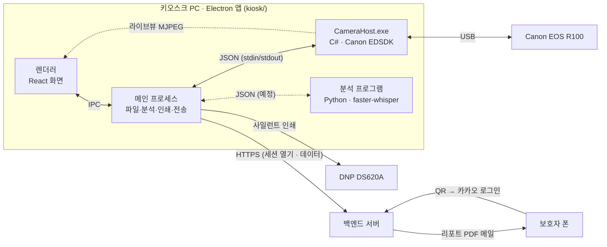

# 마이 드림 보이스 (My Dream Voice)

한국잡월드 체험관에 설치하는 **AI 음성 분석 기반 체험형 포토 키오스크**입니다.
아이가 직업 하나를 골라 그 직업의 짧은 시나리오를 따라 문장 2개를 말하고, 그 직업 프레임으로 네컷 사진을 찍으면 —

- **아이에게**: 네컷 사진 (가로, 현장 인화) + 화면 안내 (A모드: 긍정 문구 · B모드: 리포트 미리보기)
- **보호자에게**: 오늘 말한 문장에서 **ㅅ · ㅆ · ㄹ** 소리가 AI에 어떻게 인식됐는지 관찰한 리포트 (체험 전에 카카오 로그인 또는 이메일 입력 → 그 이메일로)

발음 분석은 **키오스크 안에서만(오프라인)** 합니다. 인터넷은 B모드에서 **보호자 연결(세션 열기)** 과 **리포트 데이터 전송** 두 순간에만 씁니다.
직업은 역할놀이 소재일 뿐, 어떤 직업을 추천하지는 않습니다.

> **현재 단계: v2 화면 흐름을 임시 화면으로 끝까지 돌리는 단계** — 기획 v2(2026-11-16 · 11-18 · 11-19 · 11-20)대로 화면 · 흐름 · 가로 네컷을 새로 썼습니다. 화면 디자인(색 · 글꼴 · 배치)은 P-00 · P-01 · P-02 · P-02a · P-03 · P-04까지만 입혔고(나머지 화면은 임시), 받아쓰기 · 정밀 분석 · 백엔드 서버는 가짜(mock)로 자리만 잡아 둔 상태입니다.
>
> v1 화면 흐름 코드는 고쳐 쓰지 않고 [`legacy/kiosk-v1/`](legacy/README.md)로 빼 두었습니다 (참고용). 진행 순서와 지금 어디까지 왔는지는 [V2_BUILD_CHECKLIST.md](V2_BUILD_CHECKLIST.md), 코드에서 고칠 곳 목록은 [V2_PLAN.md](V2_PLAN.md)에 있습니다.

---

## 체험 흐름 (v2)

```
대기 → 모드 선택 → 동의(B) → 보호자 연결(B) → 연령(B) → 직업 1개 → 발화(B) → 촬영 4컷 → 분석 및 프린트 → 완료 창(5초) → 대기
                  (A는 모드 선택에서 바로 직업 선택으로 — 동의 · 보호자 연결 없음)
```

| 모드 | 아이가 하는 것 | 받는 것 |
| --- | --- | --- |
| **A. 사진만** | 직업 1개 고르기 → 촬영 (동의 화면 없음 · 모드 선택 화면의 안내 한 줄은 2026-11-22 화면 디자인에서 뺌 — 필요 여부는 법무 확인) | 네컷 인쇄 |
| **B. 목소리도** | 보호자 동의 → **보호자 연결**(카카오 로그인 QR 또는 이메일 직접 입력) → 나이(만 4 · 5 · 6+) → 직업 1개 → 시나리오를 따라 문장 2개 말하기 → 촬영 | 네컷 인쇄 + 보호자 메일 리포트 |

- **보호자 연결**에서 세션이 열리고, 인쇄가 끝나면 닫힙니다. 서버에 연결이 안 되면 [다시 시도], 그래도 안 되면 [사진만 찍기]로 A모드로 넘어갑니다.
- **발화**: 문장을 먼저 들려주고(음성 + 자막) "이제 말해 보자!" → 아이가 [말하기 시작] · [다 말했어요]를 눌러 녹음합니다. 받아쓰기로 확인해 인식이 50% 미만이면 1회 다시 말하고, 더 잘 인식된 녹음을 씁니다. 만 4세는 어절마다 끊어 따라 말합니다.

- 직업은 6개(경찰 · 우주비행사 · 가수 · 크리에이터 · 의사 · 로봇개발자) 중 하나입니다. 직업 카드가 그 직업의 네컷 프레임 그림이라, 아이가 프레임을 보고 고릅니다.
- 촬영은 7초 간격으로 4컷을 찍습니다. 네컷은 가로입니다 (사진 2×2 + 오른쪽 띠).

**분석 및 프린트 화면** 한 장에서 촬영 장면 영상을 반복 재생하며 진행도를 보여줍니다 — **B모드는 분석 중 → 프린트 중**, **A모드는 바로 프린트 중**. B모드는 분석이 끝나면 **리포트 미리보기**를 띄우고("자세한 리포트는 보호자 메일로"), 리포트 데이터를 서버로 보냅니다. 미리보기에는 관찰 결과를 넣지 않습니다. 이 화면과 인쇄물에는 QR이 없습니다.

**보호자 폰** — 보호자 연결 화면에서 카카오를 고르면:

```
화면 QR → 카카오 로그인 → "연결됐어요 · a***@naver.com으로 보내 드려요" → (체험이 끝나면) 리포트 PDF 메일
```

자세한 내용: [SPEC.md](SPEC.md) (기획) · [PAGE_SPEC.md](PAGE_SPEC.md) (화면별 정의)

---

## 구조



| 구성 | 위치 | 하는 일 |
| --- | --- | --- |
| 렌더러 | `kiosk/src/renderer` | 화면만 그린다. 파일·프린터에는 직접 손대지 않고 IPC로 요청만 한다 |
| 메인 프로세스 | `kiosk/src/main` | 세션 폴더, 발음 분석, 네컷 PDF, 인쇄, 서버 전송, 카메라 프로그램 관리 |
| 카메라 프로그램 | `kiosk/camera-host` | R100은 웹캠(UVC)이 아니라서 Canon SDK(C DLL)로 제어하는 C# 별도 프로그램 |
| 분석 프로그램 (예정) | `kiosk/analysis-host` (가칭) | 받아쓰기(faster-whisper) · 정밀 분석(스펙트로그램 · 피치 등)을 하는 파이썬 별도 프로그램. 키오스크 PC에서만 돈다 |
| 백엔드 서버 | 이 저장소 밖 | 세션 번호 발급 · 카카오 로그인 · 리포트 PDF 생성 · 메일 발송 · 저장 |
| ~~클라우드~~ | `cloud/` | v1의 업로드·QR 다운로드 서버 (Next.js · Vercel). **백엔드로 대체되어 폐기 예정** |

키오스크와 서버의 역할 · 보내는 데이터 · 세션 번호 규칙은 [SPEC.md §6](SPEC.md)에 있습니다.

---

## 현재 상태

| 상태 | 항목 |
| --- | --- |
| ✅ 동작 확인 | **v2 화면 흐름** — A모드(P-00 → P-01 → P-04 → P-06 → P-07 → 완료 창) · B모드(P-02 동의 → P-02a 보호자 연결 → P-03 → P-04 → P-05 → P-06 → P-07 → 완료 창). 개발 실행(가짜 카메라 · 가짜 인쇄 · mock 서버)에서 끝까지 확인 (2026-11-20) |
| ✅ | 동의(B만 · 체크 3개) · **보호자 연결**(QR · 이메일 직접 입력 · 화면 키보드 · 연결 실패 → 다시 시도 → 사진만 찍기) · 연령(만 4 · 5 · 6+) · 직업 6개 중 1개 |
| ✅ | **P-05 발화** — 들려주기 → [말하기 시작] / [다 말했어요] 녹음(DSP off) → "잘 듣고 있어요" → 다시 말하기 1회 → 더 나은 녹음만 남김 · 만 4세 어절마다. 받아쓰기는 아직 가짜(개발용 통과/실패 버튼) |
| ✅ | 촬영 — 7초 간격 4컷 · 촬영 장면 녹화 · **가로 네컷 1844×1240**(QR 없음 · 돌리지 않고 1:1 PDF) |
| ✅ | **분석 및 프린트 통합 화면** — 촬영 영상 반복 재생 · A 긍정 문구 / B 리포트 미리보기(관찰 결과 가림) · 서버 전송(mock) · 인쇄 · 5초 완료 창 · 세션 폴더 삭제 |
| ✅ | 실제 카메라 R100 — 키오스크에서 촬영 확인 (v1 때 · 자가진단 결과 분석은 진행 중). 카메라 · 인쇄 · 녹음 모듈은 v1에서 검증된 것을 그대로 쓴다 |
| ✅ | D-01 하드웨어 점검 (장치 목록 · 마이크 레벨 · 16kHz WAV 녹음 · 스피커 · 카메라 자가진단 · 인쇄 · 받아쓰기 점검) |
| 🟡 | **키오스크에서 다시 확인할 것** — v2 흐름을 실제 카메라 · 마이크 · 프린터로 · 가로 네컷 실물 인쇄(색 · 잘림 — D-01 점검표) · 촬영 장면 녹화가 실제 라이브뷰에서 되는지 · 설치판(`npm run dist`) |
| 🟡 | **화면 디자인** — 화면마다 디자인(1920×1080)을 받아 입히는 중이다. **P-00 타이틀 · P-01 모드 선택 · P-02 동의 · P-02a 보호자 연결 · P-03 연령 선택 · P-04 직업 선택 화면까지 입혔고**, 나머지 화면은 색 · 글꼴 · 배치가 임시다 ([V2_BUILD_CHECKLIST.md](V2_BUILD_CHECKLIST.md) 7단계 · 디자인 요청 목록) |
| ⬜ | **받아쓰기 · 정밀 분석** — 지금은 `kiosk/src/main/mock/stt.ts` · `mock/analysis.ts`가 가짜 결과를 준다. **파이썬 별도 프로그램**(faster-whisper + 분석)으로 교체 예정 — 카메라 프로그램처럼 앱 안에 넣는다 |
| ⬜ | **백엔드 연동** — 지금은 `kiosk/src/main/mock/server.ts`가 서버 대답을 흉내 낸다 (세션 열기 · 로그인 확인 · 이메일 전달 · 데이터 전송). API 합의 뒤 HTTP로 교체 (SPEC T-14) |
| ⬜ | 미확정 콘텐츠 — 직업별 시나리오 18종(타깃 문장 2개씩 · 지금은 경찰 문장 1만 예시) · 문장 음성 파일 · 긍정 문구 · 직업 프레임 그림 6종과 칸 좌표 (규격 [SPEC.md](SPEC.md) §4-1) · 동의 문구 전문 · 컨셉 문구 |
| ⬜ | M-01 무조작 안내 · 용지 없음 감지 · 운영 설정 (전체화면 고정 · 자동 실행 · 재기동 · 개발용 조작 숨기기) |

---

## 화면과 코드

화면 번호 · 파일명은 [PAGE_SPEC.md](PAGE_SPEC.md) v0.3(v2)을 따릅니다. 화면 파일은 `kiosk/src/renderer/screens/`에 있습니다.

| 화면 | 하는 일 | 파일 |
| --- | --- | --- |
| P-00 대기 | 타이틀 겸 어트랙트 · 터치하면 세션 폴더 발급 | `P00Attract.tsx` |
| P-01 모드 선택 | A 사진만 / B 목소리도 (카드 = 이름 + 한 줄 설명) | `P01ModeSelect.tsx` |
| P-02 동의 (B) | 보호자 동반 · 목소리 · 사진·영상 — 모두 체크해야 시작 | `P02Consent.tsx` |
| P-02a 보호자 연결 (B) | 카카오 QR 또는 이메일 직접 입력 → 세션 열기. 연결 실패는 이 화면 안에서 처리 | `P02aGuardianLink.tsx` · `components/EmailKeyboard.tsx` |
| P-03 연령 (B) | 만 4 · 5 · 6+ | `P03AgeSelect.tsx` |
| P-04 직업 | 6종 중 1개 (카드 = 네컷 프레임 — 지금은 6개 직업 공통 프레임 1종) | `P04JobSelect.tsx` · `photo/FramePreview.tsx` |
| P-05 발화 (B) | 시나리오 + 타깃 문장 2개 — 들려주고 따라 말하기 · 다시 말하기 | `P05Speak.tsx` · `audio/clips.ts` · `audio/useAudioCapture.ts` |
| P-06 촬영 | 라이브뷰 · 7초 간격 4컷 · 장면 녹화 · 네컷 합성 | `P06Capture.tsx` · `photo/recordLiveView.ts` · `photo/composeFourCut.ts` |
| P-07 분석 및 프린트 | 진행도 · 영상 · 긍정 문구(A) / 리포트 미리보기(B) · 분석 · 전송 · 인쇄 | `P07AnalyzePrint.tsx` · `report/ReportPreview.tsx` · `report/copy.ts` |
| M-02 오류 안내 | 카메라/마이크 없음 · 인쇄 실패 | `M02Fallback.tsx` |
| M-03 완료 | 5초 뒤 닫힘 · 세션 닫기 · 삭제 → P-00 | `M03Done.tsx` |
| D-01 하드웨어 체크 | 개발 전용 — 장치 · 카메라 · 마이크 · 인쇄 · 받아쓰기 점검 | `D01HardwareCheck.tsx` |

화면 오른쪽 아래의 **개발용 바(DevBar)** 로 화면을 건너뛰고, 가짜 분석 결과(전부 잘 인식됨 / 일부 다르게 / 전부 판단 보류 / 분석 실패) · 가짜 받아쓰기(직접 고르기 / 항상 통과 / 항상 실패) · 가짜 서버(연결됨 / 끊김) · 인쇄(실제 / 가짜)를 바꿀 수 있습니다.

### 코드 읽는 순서

1. `kiosk/src/shared/types.ts` — 화면과 메인이 주고받는 모든 데이터와 IPC 채널
2. `kiosk/src/renderer/store/session.ts` — 화면 전환과 세션 데이터 (라우터 없이 이 스토어 하나로 움직인다. 순서는 `nextScreen()` 한 곳)
3. `kiosk/src/main/ipc.ts` — 요청이 어느 모듈로 가는지
4. 관심 있는 화면(`screens/`)이나 모듈

---

## 폴더

```
mdv/
├── README.md            ← 이 문서
├── CLAUDE.md            프로젝트 규칙 · 금지 사항 (먼저 읽기)
├── SPEC.md              기획 확정본 (v2) + 미결 사항(T-xx)
├── PAGE_SPEC.md         화면 정의서 (v2 — P-xx / M-xx)
├── V2_PLAN.md           v2 코드 개편 할 일 (고칠 곳 목록)
├── V2_BUILD_CHECKLIST.md v2 개편 진행 순서 · 지금 상태 · 디자인 요청 목록
├── SPIKE_PLAN.md        스파이크 범위 · 완료 기준 (v1 기준 기록)
├── docs/                리포트 문구 원본, 화면 흐름도(user-flow/ — v2는 index.html, 이전 판은 v1.html), 기획 문서
├── kiosk/               키오스크 앱 (Electron + Vite + React + TS)
│   ├── src/main/        메인 프로세스 (mock/ = 받아쓰기 · 분석 · 서버 흉내)
│   ├── src/preload/     렌더러에 window.api를 여는 통로
│   ├── src/renderer/    화면 (screens/ · store/ · photo/ · report/ · audio/)
│   ├── src/shared/      양쪽 공용 — types.ts(IPC 계약) · jobs.ts(직업 · 시나리오) · constants.ts(네컷 규격 · 시간)
│   └── camera-host/     CameraHost.exe (C# · .NET 10)
├── legacy/              빼 둔 옛 코드 — kiosk-v1/src (v1 화면 흐름 · 참고용, 빌드 대상 아님)
└── cloud/               v1 결과물 전달 서버 (Next.js on Vercel) — 폐기 예정
```

파일 단위 설명은 [kiosk/README.md](kiosk/README.md)에 있습니다.

---

## 시작하기

**필요한 것**: Windows 10/11 · Node.js 22 · .NET 10 SDK (카메라 프로그램을 빌드할 때만. 키오스크 PC에는 필요 없음)

```bash
cd kiosk
npm install
```

```bash
npm run camera:build
```

```bash
npm run dev
```

개발 실행은 **가짜 카메라 · 가짜 인쇄(종이를 쓰지 않음) · 가짜 서버**로 동작하고, 첫 화면은 D-01 하드웨어 점검입니다. `[플로우 시작]`으로 P-00부터 진행합니다.
B모드의 보호자 연결(P-02a)에서는 화면 아래 개발용 띠의 `[카카오 로그인 완료 흉내]`를 누르면 다음으로 넘어가고, 발화(P-05)에서는 녹음 뒤 개발용 `[통과] / [실패] / [무음]`으로 받아쓰기 결과를 고릅니다.

### Canon EDSDK (저장소에 없음)

실제 카메라를 쓰려면 Canon에서 승인받은 EDSDK의 **64비트 DLL 2개**를 직접 넣어야 합니다.
Canon 이용약관상 DLL은 앱 패키지에만 포함하고 단독 배포하지 않으므로 저장소에서는 제외(`.gitignore`)합니다.

```
kiosk/camera-host/edsdk/EDSDK.dll      ← EDSDK_64/Dll/
kiosk/camera-host/edsdk/EdsImage.dll   ← EDSDK_64/Dll/
```

넣은 뒤 `npm run camera:build`를 다시 실행하면 exe 옆으로 복사됩니다. DLL이 없어도 가짜 카메라는 그대로 동작합니다.

### 설치 파일 만들기

```bash
npm run dist
```

`kiosk/dist/MyDreamVoice-Setup-<버전>.exe`(설치판)와 `MyDreamVoice-Portable-<버전>.exe`가 나옵니다.
**설치판은 실제 카메라(EDSDK)가 기본**입니다. 서명이 없어 처음 실행 시 "Windows의 PC 보호" → 추가 정보 → 실행.

### 테스트

| 명령 | 확인하는 것 |
| --- | --- |
| `npm run typecheck` | 메인·렌더러 타입 검사 |
| `npm run camera:test` | 카메라 프로그램 프로토콜 (가짜 카메라 20개 항목) |
| `npm run camera:test:edsdk` | 실제 R100 — 연결·라이브뷰·4컷·지연 측정. 카메라가 없으면 SDK 로드·탐색까지만 |
| D-01 `[실카메라 자가진단]` | 키오스크에서 버튼 하나로 위 시험 + 결과 폴더(사진·로그)를 바탕화면에 생성 |

카메라 로그: `%APPDATA%\MyDreamVoice\logs\camera-YYYYMMDD.log`

---

## 환경 변수 (키오스크)

| 변수 | 뜻 | 기본값 |
| --- | --- | --- |
| `MDV_CAMERA` | 카메라 백엔드 `fake` \| `edsdk` | 개발 실행 `fake`, 설치판 `edsdk` |
| `MDV_DATA_DIR` | 세션 폴더 위치 | 개발 `kiosk/sessions`, 설치판 `%APPDATA%\MyDreamVoice\sessions` |
| `MDV_PRINT` | P-07 인쇄 `real` \| `fake` (fake = 종이를 쓰지 않고 인쇄 시간만 흉내) | 개발 실행 `fake`, 설치판 `real` |
| `MDV_SELFTEST_FAKE`, `MDV_SELFTEST_DIR` | 개발 PC에서 자가진단 검증용 | — |

> 백엔드 주소 · API 인증 키 변수는 아직 없습니다 — API 합의 뒤에 정합니다 (SPEC T-14). 지금은 서버 대답을 앱 안에서 흉내 냅니다 (`kiosk/src/main/mock/server.ts`).
> v1 업로드 변수(`MDV_UPLOAD_ENDPOINT` · `MDV_UPLOAD_SECRET`)는 더 이상 쓰지 않습니다. v1 `cloud/`의 변수는 `cloud/.env.example`에 있습니다.

---

## 지켜야 할 원칙 (요약)

자세한 내용과 이유는 [CLAUDE.md](CLAUDE.md)에 있습니다.

- 아이 음성은 기기 밖으로 나가지 않는다. 클라우드 STT·분석 API 금지
- 서버로 보내는 것은 **관찰 데이터 · 리포트 문구 · 네컷 이미지**뿐. 원본 WAV · 개별 사진 · 촬영 영상은 보내지 않는다
- 녹음 때 마이크 DSP(잡음 제거·에코 제거·자동 음량)는 모두 끈다
- 아이 화면에는 관찰 결과를 보이지 않는다 — A모드는 긍정 문구, B모드 리포트 미리보기도 관찰 결과는 가린다. 리포트에 점수·판정·또래 비교를 넣지 않는다
- "판정" 표현 금지 — 결과는 "잘 인식됨 / 다르게 인식됨" 두 가지 관찰로만, 주어는 아이가 아니라 AI의 인식
